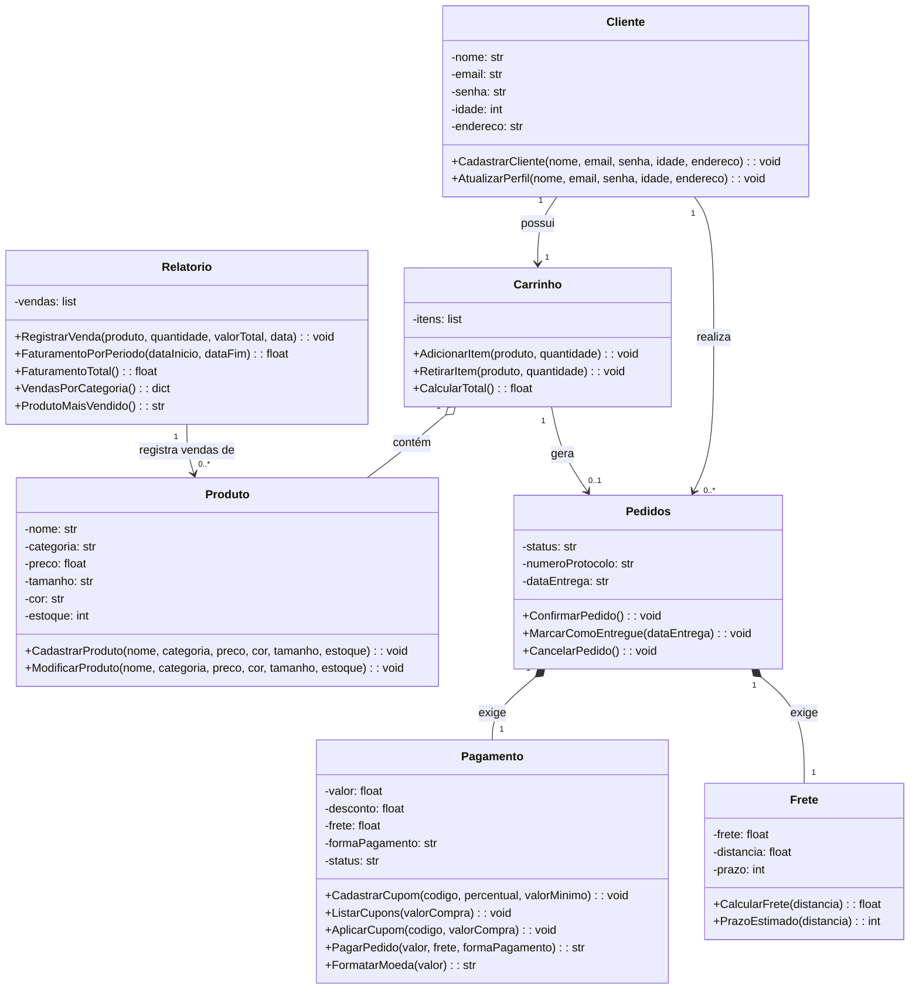

# Sistema-de-Loja-Virtual-Simplificada

## DESCRIÇÃO DO PROJETO:
- Desenvolvimento de um software simples para uma loja virtual com finalidade de obtenção de nota no trabalho da disciplina de PROGRAMAÇÃO ORIENTADA A OBJETOS do 2° semestre do curso de Engenharia de Software da Universidade Federal do Cariri (UFCA).

## OBJETIVOS:
- Criação de um software simples funcional para um sistema de administração de uma loja virtual, sendo exigidos alguns requisitos, como:
  - Cadastro de Produtos e Clientes;
  - Carrinho;
  - Pedidos;
  - Pagamentos;
  - Cálculo de Frete;
  - Relatório de Vendas.
- Contendo também, de forma obrigatória, um método de salvamento de dados implementado no software, como um arquivo JSON ou SQLite.

## ESTRUTURA PLANEJADA DE CLASSES:
- Classe: **Cliente**
  - Atributos:
    - Nome
    - E-mail
    - Senha
    - Idade
    - Endereço

  - Métodos:
    - CadastrarCliente()
    - AtualizarPerfil()

- Classe: **Produto**
  - Atributos:
    - Nome
    - Categoria
    - Preço
    - Tamanho (Opcional)
    - Cor
    - Estoque (disponibilidade)

  - Métodos:
    - CadastrarProduto()
    - ModificarProduto()

- Classe: **Carrinho**
  - Atributos:
    - Itens (lista em que cada item guarda o produto e a quantidade adicionada)

  - Métodos:
    - AdicionarItem()
    - RetirarItem()
    - CalcularTotal()

- Classe: **Pedidos**
  - Atributos:
    - Status (PENDENTE, ENVIADO, ENTREGUE ou CANCELADO)
    - Número de Protocolo (gerado automaticamente ao confirmar o pedido, também usado como código de rastreio)
    - Data de Entrega

  - Métodos:
    - ConfirmarPedido()
    - MarcarComoEntregue()
    - CancelarPedido()

  - Regras:
    - Ao confirmar, o pedido passa de PENDENTE para ENVIADO e recebe o número de protocolo.
    - Só um pedido ENVIADO pode ser marcado como ENTREGUE, registrando a data de entrega.
    - Um pedido pode ser cancelado em qualquer estado, exceto depois de ENTREGUE.

- Classe: **Pagamento**
  - Atributos:
    - Valor
    - Desconto (percentual)
    - Frete
    - Forma de Pagamento (PIX, CARTAO_DEBITO, CARTAO_CREDITO ou BOLETO)
    - Status (PENDENTE ou PAGO)
    - Cupons válidos (compartilhados por todos os pagamentos)

  - Métodos:
    - CadastrarCupom()
    - ListarCupons()
    - AplicarCupom()
    - PagarPedido()
    - FormatarMoeda()

  - Regras:
    - Cada cupom tem um código, um percentual de desconto e um valor mínimo de compra.
    - O cupom só é aplicado se o valor da compra atingir o valor mínimo do cupom.
    - Valor total = valor com desconto + frete.

- Classe: **Frete**
  - Atributos:
    - Valor
    - Distância
    - Prazo (em dias)

  - Métodos:
    - CalcularFrete()
    - PrazoEstimado()

  - Regras:
    - Valor do frete: R$ 0,10 por km.
    - Distância máxima atendida: 3000 km (acima disso não há cálculo de frete nem de prazo).
    - Prazo estimado por faixa de distância:

      | Distância | Prazo |
      |---|---|
      | até 100 km | 2 dias |
      | até 500 km | 5 dias |
      | até 1500 km | 8 dias |
      | até 2000 km | 11 dias |
      | até 2500 km | 14 dias |
      | até 3000 km | 17 dias |

- Classe: **Relatório de Vendas**
  - Atributos:
    - Vendas (lista com produto, quantidade, valor total e data de cada venda)

  - Métodos:
    - RegistrarVenda()
    - FaturamentoPorPeriodo()
    - FaturamentoTotal()
    - VendasPorCategoria()
    - ProdutoMaisVendido()

## UML TEXTUAL:
-----------
### Cliente
-----------
Atributos:
  - Nome: str
  - E-mail: str
  - Senha: str
  - Idade: int
  - Endereço: str

Métodos:
  - CadastrarCliente(nome: str, email: str, senha: str, idade: int, endereco: str): void
  - AtualizarPerfil(nome: str = None, email: str = None, senha: str = None, idade: int = None, endereco: str = None): void
-------------------------------------------------------------------------------------------------------------------------

### Produto
-----------
Atributos:
  - Nome: str
  - Categoria: str
  - Preço: float
  - Tamanho (Opcional): str
  - Cor: str
  - Estoque (disponibilidade): int

Métodos:
  - CadastrarProduto(nome: str, categoria: str, preco: float, cor: str, tamanho: str [0..1], estoque: int): void
  - ModificarProduto(nome: str = None, categoria: str = None, preco: float = None, cor: str = None, tamanho: str = None, estoque: int = None): void
-----------------------------------------------------------------------------------------------------------------------------------------------------------

### Carrinho
------------
Atributos:
  - Itens: list (cada item: produto + quantidade)

Métodos:
  - AdicionarItem(produto: Produto, quantidade: int): void
  - RetirarItem(produto: Produto, quantidade: int): void
  - CalcularTotal(): float
--------------------------------------------------------------------------------

### Pedidos
------------
Atributos:
  - Status: str
  - Número de Protocolo: str
  - Data de Entrega: str (DD/MM/AAAA)

Métodos:
  - ConfirmarPedido(): void
  - MarcarComoEntregue(dataEntrega: str): void
  - CancelarPedido(): void
---------------------------------------

### Pagamento
--------------
Atributos:
  - Valor: float
  - Desconto: float (percentual)
  - Frete: float
  - Forma de Pagamento: str
  - Status: str
  - Cupons Válidos: dict (código -> percentual e valor mínimo)

Métodos:
  - CadastrarCupom(codigo: str, percentual: float, valorMinimo: float): void
  - ListarCupons(valorCompra: float): void
  - AplicarCupom(codigo: str, valorCompra: float): void
  - PagarPedido(valor: float, frete: float, formaPagamento: str): str
  - FormatarMoeda(valor: float): str
------------------------------------------------------------------

### Frete
---------
Atributos:
  - Valor: float
  - Distância: float
  - Prazo: int (dias)

Métodos:
  - CalcularFrete(distancia: float): float | None
  - PrazoEstimado(distancia: float): int | None
------------------------------------------------------------------------

### Relatório de Vendas
-----------------------
Atributos:
  - Vendas: list (cada venda: produto, quantidade, valorTotal, data)

Métodos:
  - RegistrarVenda(produto: Produto, quantidade: int, valorTotal: float, data: str): void
  - FaturamentoPorPeriodo(dataInicio: str, dataFim: str): float
  - FaturamentoTotal(): float
  - VendasPorCategoria(): dict
  - ProdutoMaisVendido(): str | None
---------------------------------------------------------------------------------------

## DIAGRAMA DE CLASSES:
-----------------------

