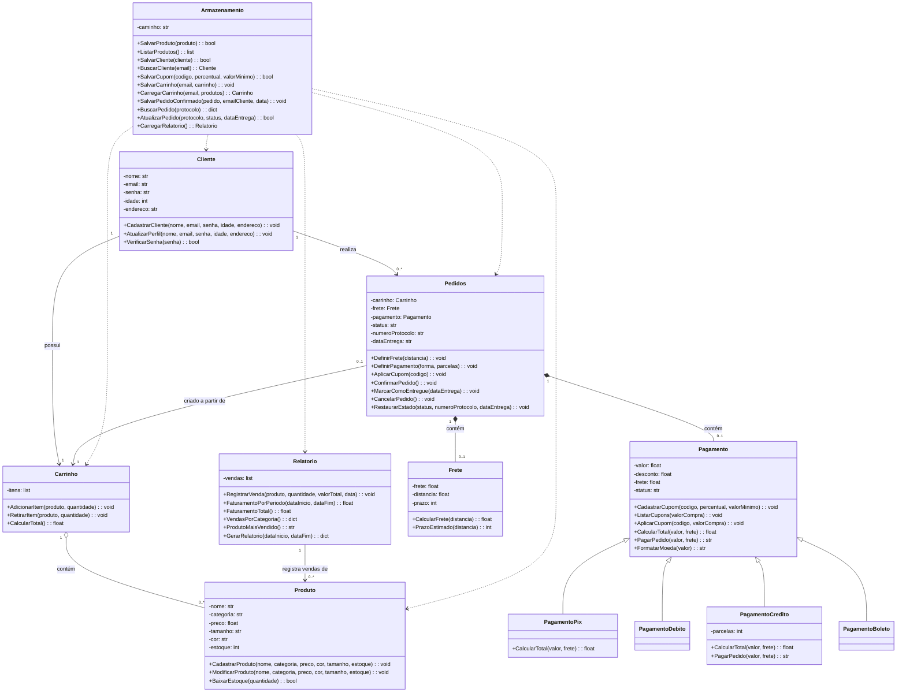

# Sistema-de-Loja-Virtual-Simplificada
 
## DESCRIÇÃO DO PROJETO:
- Desenvolvimento de um software simples para uma loja virtual com finalidade de obtenção de nota no trabalho da disciplina de PROGRAMAÇÃO ORIENTADA A OBJETOS do 2° semestre do curso de Engenharia de Software da Universidade Federal do Cariri (UFCA).
## OBJETIVOS:
- Criação de um software simples funcional para um sistema de administração de uma loja virtual, sendo exigidos alguns requisitos, como:
  - Cadastro de Produtos e Clientes;
  - Carrinho;
  - Pedidos;
  - Pagamentos;
  - Cálculo de Frete;
  - Relatório de Vendas.
- Contendo também, de forma obrigatória, um método de salvamento de dados implementado no software, como um arquivo JSON ou SQLite (neste projeto: arquivo JSON).
- Interface de linha de comando (CLI) com subcomandos.
- Herança funcional entre classes (formas de pagamento) e relação entre classes (Pedidos, Carrinho, Frete e Pagamento).
 
## ESTRUTURA PLANEJADA DE CLASSES:
- Classe: **Cliente**
  - Atributos:
    - Nome
    - E-mail
    - Senha
    - Idade
    - Endereço
  - Métodos:
    - CadastrarCliente()
    - AtualizarPerfil()
    - VerificarSenha()
  - Regras:
    - O e-mail identifica o cliente e é único (maiúsculas e minúsculas são ignoradas).
    - A senha é guardada como foi digitada, sem criptografia.
- Classe: **Produto**
  - Atributos:
    - Nome
    - Categoria
    - Preço
    - Tamanho (Opcional)
    - Cor
    - Estoque (disponibilidade)
  - Métodos:
    - CadastrarProduto()
    - ModificarProduto()
    - BaixarEstoque()
  - Regras:
    - O nome do produto é único (maiúsculas e minúsculas são ignoradas).
    - Não é possível baixar mais unidades do que há em estoque.
- Classe: **Carrinho**
  - Atributos:
    - Itens (lista em que cada item guarda o produto e a quantidade adicionada)
  - Métodos:
    - AdicionarItem()
    - RetirarItem()
    - CalcularTotal()
  - Regras:
    - Adicionar um produto que já está no carrinho soma a quantidade.
    - Se for pedida mais quantidade do que há em estoque (considerando o que já está no carrinho), é adicionado apenas o que cabe e o cliente é avisado.
    - Retirar diminui a quantidade aos poucos e remove o item quando chega a zero.
- Classe: **Pedidos**
  - Atributos:
    - Carrinho (recebido na criação do pedido)
    - Frete (criado pelo próprio pedido)
    - Pagamento (criado pelo próprio pedido, em uma das formas: Pix, débito, crédito ou boleto)
    - Status (PENDENTE, ENVIADO, ENTREGUE ou CANCELADO)
    - Número de Protocolo (gerado automaticamente ao confirmar o pedido, também usado como código de rastreio)
    - Data de Entrega
    - Valor total (calculado a partir do carrinho, do frete e do pagamento)
  - Métodos:
    - DefinirFrete()
    - DefinirPagamento()
    - AplicarCupom()
    - ConfirmarPedido()
    - MarcarComoEntregue()
    - CancelarPedido()
    - RestaurarEstado()
  - Regras:
    - O pedido coordena a compra: usa o valor do carrinho, o valor do frete e a forma de pagamento escolhida.
    - Frete e pagamento só podem ser definidos ou alterados enquanto o pedido está PENDENTE.
    - O cupom só pode ser aplicado depois de definida a forma de pagamento.
    - Para confirmar, o carrinho precisa ter itens, o frete e o pagamento precisam estar definidos e o estoque precisa cobrir todos os itens.
    - Ao confirmar, o pagamento é realizado; só se for concluído o estoque é baixado, o pedido passa de PENDENTE para ENVIADO e recebe o número de protocolo.
    - Só um pedido ENVIADO pode ser marcado como ENTREGUE, registrando a data de entrega.
    - Um pedido pode ser cancelado em qualquer estado, exceto depois de ENTREGUE.
    - `RestaurarEstado()` reconstrói o status, o protocolo e a data de entrega de um pedido gravado no arquivo, para que ele possa ser marcado como entregue.
- Classe: **Pagamento**
  - Atributos:
    - Valor
    - Desconto (percentual)
    - Frete
    - Forma (definida pela classe-filha: PIX, CARTAO_DEBITO, CARTAO_CREDITO ou BOLETO)
    - Status (PENDENTE ou PAGO)
    - Cupons válidos (compartilhados por todos os pagamentos e por todas as classes-filhas)
  - Métodos:
    - CadastrarCupom()
    - ListarCupons()
    - AplicarCupom()
    - CalcularTotal()
    - PagarPedido()
    - FormatarMoeda()
  - Regras:
    - Cada cupom tem um código, um percentual de desconto e um valor mínimo de compra.
    - O cupom só é aplicado se o valor da compra atingir o valor mínimo do cupom.
    - Valor total = valor com desconto + frete. Cada forma de pagamento (classe-filha) acrescenta a sua própria regra por cima desse cálculo.
    - A classe `Pagamento` sozinha não tem forma de pagamento definida e, por isso, não conclui um pagamento.
- Classe: **PagamentoPix** (herda de `Pagamento`)
  - Forma: PIX
  - Regra: 5% de desconto sobre o total.
- Classe: **PagamentoDebito** (herda de `Pagamento`)
  - Forma: CARTAO_DEBITO
  - Regra: sem alteração no valor.
- Classe: **PagamentoCredito** (herda de `Pagamento`)
  - Forma: CARTAO_CREDITO
  - Atributos:
    - Parcelas
  - Regra: até 3 parcelas sem juros; acima disso, 3% de juros sobre o total.
- Classe: **PagamentoBoleto** (herda de `Pagamento`)
  - Forma: BOLETO
  - Regra: sem alteração no valor.
- Classe: **Frete**
  - Atributos:
    - Valor
    - Distância
    - Prazo (em dias)
  - Métodos:
    - CalcularFrete()
    - PrazoEstimado()
  - Regras:
    - Valor do frete: R$ 0,10 por km.
    - Distância máxima atendida: 3000 km (acima disso não há cálculo de frete nem de prazo).
    - Prazo estimado por faixa de distância:
      | Distância | Prazo |
      |---|---|
      | até 100 km | 2 dias |
      | até 500 km | 5 dias |
      | até 1500 km | 8 dias |
      | até 2000 km | 11 dias |
      | até 2500 km | 14 dias |
      | até 3000 km | 17 dias |
- Classe: **Relatório de Vendas** (`Relatorio`)
  - Atributos:
    - Vendas (lista com produto, quantidade, valor total e data de cada venda)
  - Métodos:
    - RegistrarVenda()
    - FaturamentoPorPeriodo()
    - FaturamentoTotal()
    - VendasPorCategoria()
    - ProdutoMaisVendido()
    - GerarRelatorio()
  - Regras:
    - O valor de cada venda é o preço do produto vezes a quantidade, sem frete e sem descontos.
    - `GerarRelatorio()` reúne quantidade de vendas, faturamento total, faturamento do período (quando informado), vendas por categoria e produto mais vendido.
- Classe: **Armazenamento**
  - Atributos:
    - Caminho do arquivo JSON
  - Métodos:
    - SalvarProduto() e ListarProdutos()
    - SalvarCliente(), BuscarCliente() e ListarClientes()
    - SalvarCupom() e ListarCupons()
    - SalvarCarrinho() e CarregarCarrinho()
    - SalvarPedidoConfirmado(), BuscarPedido(), ListarPedidos() e AtualizarPedido()
    - CarregarRelatorio()
  - Regras:
    - Cuida apenas da leitura e da gravação do arquivo; as regras da loja ficam nas outras classes.
    - Ao carregar um carrinho, a quantidade de cada item respeita o estoque atual.
## UML TEXTUAL:
-----------
### Cliente
-----------
Atributos:
  - Nome: str
  - E-mail: str
  - Senha: str
  - Idade: int
  - Endereço: str
Métodos:
  - CadastrarCliente(nome: str, email: str, senha: str, idade: int, endereco: str): void
  - AtualizarPerfil(nome: str = None, email: str = None, senha: str = None, idade: int = None, endereco: str = None): void
  - VerificarSenha(senha: str): bool
-------------------------------------------------------------------------------------------------------------------------
 
### Produto
-----------
Atributos:
  - Nome: str
  - Categoria: str
  - Preço: float
  - Tamanho (Opcional): str
  - Cor: str
  - Estoque (disponibilidade): int
Métodos:
  - CadastrarProduto(nome: str, categoria: str, preco: float, cor: str, tamanho: str [0..1], estoque: int): void
  - ModificarProduto(nome: str = None, categoria: str = None, preco: float = None, cor: str = None, tamanho: str = None, estoque: int = None): void
  - BaixarEstoque(quantidade: int): bool
-----------------------------------------------------------------------------------------------------------------------------------------------------------
 
### Carrinho
------------
Atributos:
  - Itens: list (cada item: produto + quantidade)
Métodos:
  - AdicionarItem(produto: Produto, quantidade: int): void
  - RetirarItem(produto: Produto, quantidade: int): void
  - CalcularTotal(): float
--------------------------------------------------------------------------------
 
### Pedidos
------------
Atributos:
  - Carrinho: Carrinho
  - Frete: Frete [0..1]
  - Pagamento: Pagamento [0..1]
  - Status: str
  - Número de Protocolo: str
  - Data de Entrega: str (DD/MM/AAAA)
  - Valor Total: float
Métodos:
  - DefinirFrete(distancia: float): void
  - DefinirPagamento(forma: str, parcelas: int = 1): void
  - AplicarCupom(codigo: str): void
  - ConfirmarPedido(): void
  - MarcarComoEntregue(dataEntrega: str): void
  - CancelarPedido(): void
  - RestaurarEstado(status: str, numeroProtocolo: str, dataEntrega: str): void
---------------------------------------
 
### Pagamento
--------------
Atributos:
  - Valor: float
  - Desconto: float (percentual)
  - Frete: float
  - Forma: str (definida pela classe-filha)
  - Status: str
  - Cupons Válidos: dict (código -> percentual e valor mínimo)
Métodos:
  - CadastrarCupom(codigo: str, percentual: float, valorMinimo: float): void
  - ListarCupons(valorCompra: float): void
  - AplicarCupom(codigo: str, valorCompra: float): void
  - CalcularTotal(valor: float, frete: float): float
  - PagarPedido(valor: float, frete: float): str
  - FormatarMoeda(valor: float): str
------------------------------------------------------------------
 
### PagamentoPix (herda de Pagamento)
-------------------------------------
Atributos:
  - Desconto do Pix: int (5, percentual)
Métodos:
  - CalcularTotal(valor: float, frete: float): float   (sobrescreve o da classe-mãe)
-------------------------------------------------------------------------------
 
### PagamentoDebito (herda de Pagamento)
----------------------------------------
Sem atributos ou métodos próprios (usa os da classe-mãe).
----------------------------------------------------------
 
### PagamentoCredito (herda de Pagamento)
-----------------------------------------
Atributos:
  - Parcelas: int
  - Parcelas sem juros: int (3)
  - Juros: int (3, percentual)
Métodos:
  - CalcularTotal(valor: float, frete: float): float   (sobrescreve o da classe-mãe)
  - PagarPedido(valor: float, frete: float): str       (sobrescreve o da classe-mãe)
-----------------------------------------------------------------------------------
 
### PagamentoBoleto (herda de Pagamento)
----------------------------------------
Sem atributos ou métodos próprios (usa os da classe-mãe).
----------------------------------------------------------
 
### Frete
---------
Atributos:
  - Valor: float
  - Distância: float
  - Prazo: int (dias)
Métodos:
  - CalcularFrete(distancia: float): float | None
  - PrazoEstimado(distancia: float): int | None
------------------------------------------------------------------------
 
### Relatório de Vendas
-----------------------
Atributos:
  - Vendas: list (cada venda: produto, quantidade, valorTotal, data)
Métodos:
  - RegistrarVenda(produto: Produto, quantidade: int, valorTotal: float, data: str): void
  - FaturamentoPorPeriodo(dataInicio: str, dataFim: str): float
  - FaturamentoTotal(): float
  - VendasPorCategoria(): dict
  - ProdutoMaisVendido(): str | None
  - GerarRelatorio(dataInicio: str = None, dataFim: str = None): dict
---------------------------------------------------------------------------------------
 
### Armazenamento
-----------------
Atributos:
  - Caminho: str
Métodos:
  - SalvarProduto(produto: Produto): bool
  - ListarProdutos(): list
  - SalvarCliente(cliente: Cliente): bool
  - BuscarCliente(email: str): Cliente | None
  - ListarClientes(): list
  - SalvarCupom(codigo: str, percentual: float, valorMinimo: float): bool
  - ListarCupons(): dict
  - SalvarCarrinho(email: str, carrinho: Carrinho): void
  - CarregarCarrinho(email: str, produtos: list): Carrinho
  - SalvarPedidoConfirmado(pedido: Pedidos, emailCliente: str, data: str): void
  - BuscarPedido(protocolo: str): dict | None
  - ListarPedidos(email: str): list
  - AtualizarPedido(protocolo: str, status: str, dataEntrega: str): bool
  - CarregarRelatorio(): Relatorio
---------------------------------------------------------------------------------------
 
## DIAGRAMA DE CLASSES:
-----------------------
 
