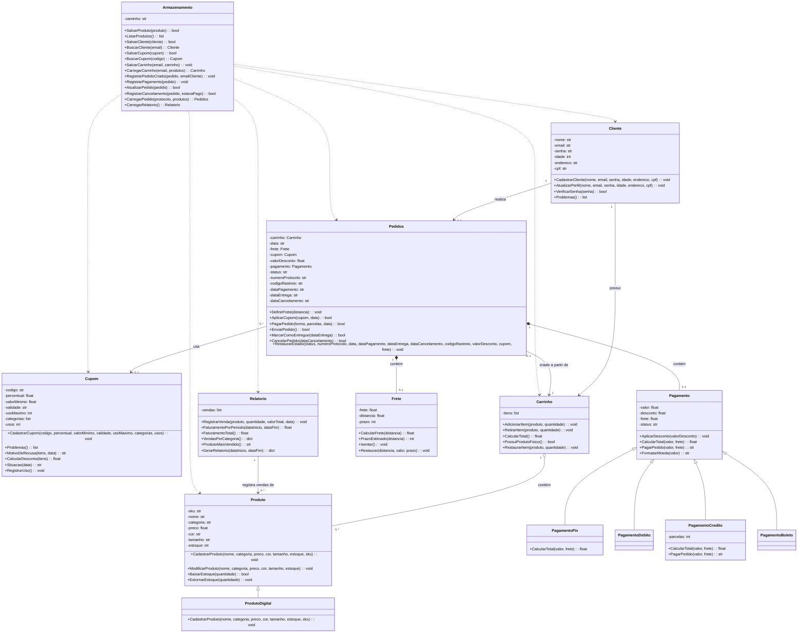

# Sistema-de-Loja-Virtual-Simplificada
 
## DESCRIÇÃO DO PROJETO:
- Desenvolvimento de um software simples para uma loja virtual com finalidade de obtenção de nota no trabalho da disciplina de PROGRAMAÇÃO ORIENTADA A OBJETOS do 2° semestre do curso de Engenharia de Software da Universidade Federal do Cariri (UFCA).
## OBJETIVOS:
- Criação de um software simples funcional para um sistema de administração de uma loja virtual, sendo exigidos alguns requisitos, como:
  - Cadastro de Produtos e Clientes;
  - Carrinho;
  - Pedidos;
  - Pagamentos;
  - Cálculo de Frete;
  - Relatório de Vendas.
- Contendo também, de forma obrigatória, um método de salvamento de dados implementado no software, como um arquivo JSON ou SQLite (neste projeto: arquivo JSON).
- Herança funcional (formas de pagamento), relação entre classes, persistência em JSON e relatório simples.
- Implementação das regras de negócio (estoque, cupons, frete, estados do pedido, cancelamento, unicidade), validação de regras (CPF, e-mail, endereço, datas, cupons), CLI com funcionamento básico e testes.

## COMO EXECUTAR E TESTAR:
- Executar um comando (a partir da pasta raiz do projeto):
```
  python main.py <subcomando> [opções]
  python main.py --help
  python main.py criar-pedido --help
```
- Os dados são gravados no arquivo `dados.json`, criado automaticamente na pasta em que o programa é executado.
- Rodar os testes:
```
  pip install pytest
  pytest
```
 
## FLUXO DA COMPRA:
```
CRIADO ──pagar──▶ PAGO ──enviar──▶ ENVIADO ──entregar──▶ ENTREGUE
   │                │
   └──cancelar──────┴──▶ CANCELADO   (se estava PAGO, o estoque é estornado)
```
 
| Etapa | Comando | O que acontece |
|---|---|---|
| 1 | `adicionar-carrinho` | o cliente monta o carrinho (limitado ao estoque) |
| 2 | `criar-pedido` | valida o cadastro, confere o estoque, calcula o frete e aplica o cupom; o pedido nasce **CRIADO** e recebe um protocolo `PEDxxxxxxxx` |
| 3 | `pagar-pedido` | confirma o pagamento na forma escolhida, **baixa o estoque**, registra o uso do cupom e a venda; o pedido vira **PAGO** |
| 4 | `enviar-pedido` | o pedido vira **ENVIADO** e recebe um código de rastreio fictício |
| 5 | `entregar-pedido` | o pedido vira **ENTREGUE**, com a data de entrega |
| — | `cancelar-pedido` | **CRIADO** ou **PAGO** (dentro da janela) viram **CANCELADO**; se estava pago, o estoque é estornado e a venda sai do relatório |
 
## REGRAS DE NEGÓCIO IMPLEMENTADAS:
| Regra do enunciado | Como foi implementada |
|---|---|
| Estoque: não criar pedido com quantidade > estoque | `criar-pedido` recusa se algum item do carrinho tem quantidade maior que o estoque; o carrinho também só aceita adicionar o que cabe |
| Estoque: baixa ao confirmar o pagamento | `Pedidos.PagarPedido()` baixa o estoque de cada item (e confere o estoque de novo na hora de pagar) |
| Estoque: estorno se cancelado após pago | `Pedidos.CancelarPedido()` devolve as unidades com `Produto.EstornarEstoque()` e a venda é removida do relatório |
| Cupons: data, uso máximo e categorias elegíveis | classe `Cupom` (`MotivoDeRecusa()` confere validade, usos e categorias; o desconto só incide sobre os itens das categorias elegíveis) |
| Cupons: o desconto não torna o total < 0 | o percentual deve estar entre 0 e 100, o desconto é limitado ao valor dos produtos e `Pagamento.CalcularTotal()` nunca fica negativo |
| Frete obrigatoriamente calculado antes do pagamento | `Pedidos.PagarPedido()` recusa o pagamento se o frete não foi definido |
| Produtos digitais não somam frete | `ProdutoDigital`; um carrinho só com produtos digitais tem frete isento (R$ 0,00, sem precisar de distância) |
| Estados CRIADO → PAGO → ENVIADO → ENTREGUE (ou → CANCELADO) | `Pedidos` só aceita as transições do fluxo acima e avisa nas demais |
| Cancelamento dentro da janela ou se ainda não ENVIADO | só pedidos CRIADO ou PAGO podem ser cancelados; um pedido PAGO só até 7 dias após o pagamento (`Pedidos.JANELA_CANCELAMENTO_DIAS`) |
| Endereço e CPF/e-mail obrigatórios e válidos para fechar o pedido | `Cliente.Problemas()` é conferido no cadastro e de novo em `criar-pedido` (CPF com dígitos verificadores, e-mail com formato válido, endereço com pelo menos 5 caracteres) |
| Unicidade: SKU único; e-mail e CPF únicos | conferida em `Armazenamento` ao salvar produtos e clientes (ignora maiúsculas, minúsculas e pontuação do CPF) |
 
## COMANDOS DA CLI:
| Subcomando | Uso | Opções |
|---|---|---|
| `cadastrar-cliente` | cliente | `--nome --email --senha --idade --endereco --cpf` |
| `atualizar-cliente` | cliente | `--email --senha` e, opcionalmente, `--nome --nova-senha --idade --endereco --cpf` |
| `cadastrar-produto` | administrador | `--sku --nome --categoria --preco --estoque` e `--cor` (físicos), `--tamanho`, `--digital` |
| `listar-produtos` | todos | lista os produtos, o tipo (físico ou digital) e o estoque |
| `cadastrar-cupom` | administrador | `--codigo --percentual --valor-minimo` e, opcionalmente, `--validade --uso-maximo --categorias` |
| `listar-cupons` | todos | `--valor` mostra só os cupons cujo valor mínimo cabe naquela compra |
| `adicionar-carrinho` | cliente | `--email --senha --sku [--quantidade]` |
| `remover-carrinho` | cliente | `--email --senha --sku [--quantidade]` |
| `ver-carrinho` | cliente | `--email --senha` |
| `criar-pedido` | cliente | `--email --senha [--distancia] [--cupom] [--data]` |
| `pagar-pedido` | cliente | `--email --senha --protocolo --forma [--parcelas] [--data]` |
| `enviar-pedido` | administrador | `--protocolo` |
| `entregar-pedido` | administrador | `--protocolo --data` |
| `cancelar-pedido` | cliente | `--email --senha --protocolo [--data]` |
| `listar-pedidos` | cliente | `--email --senha` |
| `relatorio` | administrador | sem opções, ou `--inicio` e `--fim` |
 
- O cliente é identificado por e-mail e senha em cada comando de carrinho e pedido.
- Formas de pagamento aceitas em `--forma`: PIX, CARTAO_DEBITO, CARTAO_CREDITO e BOLETO.
- Datas sempre no formato DD/MM/AAAA. Nos comandos que aceitam `--data`, o padrão é a data de hoje (a opção permite simular pedidos em dias diferentes).

## PERSISTÊNCIA (dados.json):
- Todo o estado da loja fica em um único arquivo JSON, lido e gravado pela classe `Armazenamento`:
  - `produtos`: lista de produtos (SKU, tipo físico ou digital e estoque atualizado a cada pagamento ou estorno).
  - `clientes`: lista de clientes (e-mail e CPF únicos).
  - `cupons`: dicionário código -> percentual, valor mínimo, validade, uso máximo, categorias e número de usos.
  - `carrinhos`: um carrinho por cliente, identificado pelo e-mail (SKU e quantidade).
  - `pedidos`: todos os pedidos, com itens, frete, cupom, pagamento, status, datas e códigos.
  - `vendas`: uma venda por item de pedido pago, usada pelo relatório (é removida se o pedido for cancelado).
- Cada transição do pedido (criar, pagar, enviar, entregar, cancelar) é gravada em uma única escrita no arquivo.

## ESTRUTURA PLANEJADA DE CLASSES:
- Classe: **Cliente**
  - Atributos:
    - Nome
    - E-mail
    - Senha
    - Idade
    - Endereço
    - CPF
  - Métodos:
    - CadastrarCliente()
    - AtualizarPerfil()
    - VerificarSenha()
    - Problemas()
  - Regras:
    - O e-mail e o CPF identificam o cliente e são únicos.
    - `Problemas()` devolve a lista de erros do cadastro (e-mail, CPF e endereço inválidos).
    - A senha é guardada como foi digitada, sem criptografia.
- Classe: **Produto**
  - Atributos:
    - SKU (único)
    - Nome
    - Categoria
    - Preço
    - Cor
    - Tamanho (Opcional)
    - Estoque (disponibilidade)
  - Métodos:
    - CadastrarProduto()
    - ModificarProduto()
    - BaixarEstoque()
    - EstornarEstoque()
  - Regras:
    - Não é possível baixar mais unidades do que há em estoque.
    - Produtos diferentes podem ter o mesmo nome, desde que tenham SKUs diferentes.
- Classe: **ProdutoDigital** (herda de `Produto`)
  - Regras:
    - Não tem cor nem tamanho.
    - Não soma frete ao pedido.
    - Continua controlando estoque (licenças disponíveis).
- Classe: **Cupom**
  - Atributos:
    - Código
    - Percentual de desconto
    - Valor mínimo de compra
    - Validade (opcional)
    - Uso máximo (opcional)
    - Categorias elegíveis (opcional; vazio = todas)
    - Usos
  - Métodos:
    - CadastrarCupom()
    - Problemas()
    - MotivoDeRecusa()
    - CalcularDesconto()
    - Situacao()
    - RegistrarUso()
  - Regras:
    - O percentual deve estar entre 0 (exclusivo) e 100.
    - Só é aplicado dentro da validade, enquanto houver usos disponíveis, se o carrinho tiver itens elegíveis e se a compra atingir o valor mínimo.
    - O desconto incide só sobre os itens das categorias elegíveis.
- Classe: **Carrinho**
  - Atributos:
    - Itens (lista em que cada item guarda o produto e a quantidade adicionada)
  - Métodos:
    - AdicionarItem()
    - RetirarItem()
    - CalcularTotal()
    - PossuiProdutoFisico()
    - RestaurarItem()
  - Regras:
    - Adicionar um produto que já está no carrinho soma a quantidade.
    - Se for pedida mais quantidade do que há em estoque (considerando o que já está no carrinho), é adicionado apenas o que cabe e o cliente é avisado.
    - Retirar diminui a quantidade aos poucos e remove o item quando chega a zero.
    - `RestaurarItem()` recoloca um item vindo do arquivo, sem conferir o estoque (quem confere é a criação do pedido).
- Classe: **Pedidos**
  - Atributos:
    - Carrinho (recebido na criação do pedido)
    - Data do pedido
    - Frete (criado pelo próprio pedido)
    - Cupom e valor do desconto
    - Pagamento (criado no momento de pagar, em uma das formas: Pix, débito, crédito ou boleto)
    - Status (CRIADO, PAGO, ENVIADO, ENTREGUE ou CANCELADO)
    - Número de Protocolo (`PED` + 8 dígitos, gerado na criação do pedido)
    - Código de Rastreio (gerado ao enviar)
    - Data de pagamento, de entrega e de cancelamento
  - Métodos:
    - DefinirFrete()
    - AplicarCupom()
    - PagarPedido()
    - EnviarPedido()
    - MarcarComoEntregue()
    - CancelarPedido()
    - RestaurarEstado()
  - Regras:
    - Segue o fluxo CRIADO → PAGO → ENVIADO → ENTREGUE; as demais transições são recusadas com um aviso.
    - Produtos físicos exigem a distância para calcular o frete; um carrinho só com produtos digitais tem frete isento.
    - O frete é obrigatório antes do pagamento.
    - Ao pagar, o estoque é conferido de novo e, só então, baixado; o cupom é conferido de novo e o seu uso é registrado.
    - Cancelar um pedido CRIADO não mexe no estoque; cancelar um PAGO (até 7 dias após o pagamento) estorna o estoque.
    - Pedidos ENVIADO, ENTREGUE ou CANCELADO não podem ser cancelados.
    - `RestaurarEstado()` reconstrói um pedido gravado no arquivo, para que ele possa seguir para a próxima etapa.
- Classe: **Pagamento**
  - Atributos:
    - Valor
    - Desconto (em reais, vindo do cupom)
    - Frete
    - Forma (definida pela classe-filha: PIX, CARTAO_DEBITO, CARTAO_CREDITO ou BOLETO)
    - Status (PENDENTE ou PAGO)
  - Métodos:
    - AplicarDesconto()
    - CalcularTotal()
    - PagarPedido()
    - FormatarMoeda()
  - Regras:
    - Valor total = valor dos produtos - desconto + frete (nunca abaixo de zero). Cada forma de pagamento (classe-filha) acrescenta a sua própria regra por cima desse cálculo.
    - A classe `Pagamento` sozinha não tem forma de pagamento definida e, por isso, não conclui um pagamento.
- Classe: **PagamentoPix** (herda de `Pagamento`)
  - Forma: PIX
  - Regra: 5% de desconto sobre o total.
- Classe: **PagamentoDebito** (herda de `Pagamento`)
  - Forma: CARTAO_DEBITO
  - Regra: sem alteração no valor.
- Classe: **PagamentoCredito** (herda de `Pagamento`)
  - Forma: CARTAO_CREDITO
  - Atributos:
    - Parcelas
  - Regra: até 3 parcelas sem juros; acima disso, 3% de juros sobre o total.
- Classe: **PagamentoBoleto** (herda de `Pagamento`)
  - Forma: BOLETO
  - Regra: sem alteração no valor.
- Classe: **Frete**
  - Atributos:
    - Valor
    - Distância
    - Prazo (em dias)
  - Métodos:
    - CalcularFrete()
    - PrazoEstimado()
    - Isentar()
    - Restaurar()
  - Regras:
    - Valor do frete: R$ 0,10 por km.
    - Distância máxima atendida: 3000 km (acima disso não há cálculo de frete nem de prazo).
    - `Isentar()` zera o frete (produtos digitais).
    - Prazo estimado por faixa de distância:
      | Distância | Prazo |
      |---|---|
      | até 100 km | 2 dias |
      | até 500 km | 5 dias |
      | até 1500 km | 8 dias |
      | até 2000 km | 11 dias |
      | até 2500 km | 14 dias |
      | até 3000 km | 17 dias |
- Classe: **Relatório de Vendas** (`Relatorio`)
  - Atributos:
    - Vendas (lista com produto, quantidade, valor total e data de cada venda)
  - Métodos:
    - RegistrarVenda()
    - FaturamentoPorPeriodo()
    - FaturamentoTotal()
    - VendasPorCategoria()
    - ProdutoMaisVendido()
    - GerarRelatorio()
  - Regras:
    - Só pedidos pagos entram no relatório; o valor de cada venda é o preço do produto vezes a quantidade, sem frete e sem descontos.
    - O produto mais vendido é calculado pelo SKU.
- Classe: **Armazenamento**
  - Atributos:
    - Caminho do arquivo JSON
  - Métodos:
    - SalvarProduto() e ListarProdutos()
    - SalvarCliente(), BuscarCliente(), AtualizarCliente(), ExisteClienteComEmail(), ExisteClienteComCpf() e ListarClientes()
    - SalvarCupom(), BuscarCupom() e ListarCupons()
    - SalvarCarrinho() e CarregarCarrinho()
    - RegistrarPedidoCriado(), RegistrarPagamento(), AtualizarPedido(), RegistrarCancelamento(), BuscarPedido(), ListarPedidos() e CarregarPedido()
    - CarregarRelatorio()
  - Regras:
    - Cuida apenas da leitura e da gravação do arquivo; as regras da loja ficam nas outras classes.
    - Garante a unicidade de SKU, e-mail e CPF.
- Módulos auxiliares (funções):
  - `validacoes.py`: CpfValido(), EmailValido(), EnderecoValido(), DataValida(), ConverterData() e NormalizarCpf().
  - `formatacao.py`: FormatarMoeda().
## UML TEXTUAL:
-----------
### Cliente
-----------
Atributos:
  - Nome: str
  - E-mail: str
  - Senha: str
  - Idade: int
  - Endereço: str
  - CPF: str
Métodos:
  - CadastrarCliente(nome: str, email: str, senha: str, idade: int, endereco: str, cpf: str = None): void
  - AtualizarPerfil(nome: str = None, email: str = None, senha: str = None, idade: int = None, endereco: str = None, cpf: str = None): void
  - VerificarSenha(senha: str): bool
  - Problemas(): list
-------------------------------------------------------------------------------------------------------------------------
 
### Produto
-----------
Atributos:
  - SKU: str
  - Nome: str
  - Categoria: str
  - Preço: float
  - Cor: str
  - Tamanho (Opcional): str
  - Estoque (disponibilidade): int
Métodos:
  - CadastrarProduto(nome: str, categoria: str, preco: float, cor: str, tamanho: str [0..1], estoque: int, sku: str = None): void
  - ModificarProduto(nome: str = None, categoria: str = None, preco: float = None, cor: str = None, tamanho: str = None, estoque: int = None): void
  - BaixarEstoque(quantidade: int): bool
  - EstornarEstoque(quantidade: int): void
-----------------------------------------------------------------------------------------------------------------------------------------------------------
 
### ProdutoDigital (herda de Produto)
-------------------------------------
Métodos:
  - CadastrarProduto(nome: str, categoria: str, preco: float, cor: str = None, tamanho: str = None, estoque: int = 0, sku: str = None): void   (sobrescreve o da classe-mãe; ignora cor e tamanho)
-----------------------------------------------------------------------------------------------------------------------------------------------------
 
### Cupom
---------
Atributos:
  - Código: str
  - Percentual: float
  - Valor Mínimo: float
  - Validade: str [0..1] (DD/MM/AAAA)
  - Uso Máximo: int [0..1]
  - Categorias: list
  - Usos: int
Métodos:
  - CadastrarCupom(codigo: str, percentual: float, valorMinimo: float = 0, validade: str = None, usoMaximo: int = None, categorias: list = None, usos: int = 0): void
  - Problemas(): list
  - MotivoDeRecusa(itens: list, data: str): str | None
  - CalcularDesconto(itens: list): float
  - Situacao(data: str): str
  - RegistrarUso(): void
--------------------------------------------------------------------------------------------------------
 
### Carrinho
------------
Atributos:
  - Itens: list (cada item: produto + quantidade)
Métodos:
  - AdicionarItem(produto: Produto, quantidade: int): void
  - RetirarItem(produto: Produto, quantidade: int): void
  - CalcularTotal(): float
  - PossuiProdutoFisico(): bool
  - RestaurarItem(produto: Produto, quantidade: int): void
--------------------------------------------------------------------------------
 
### Pedidos
------------
Atributos:
  - Carrinho: Carrinho
  - Data: str (DD/MM/AAAA)
  - Frete: Frete [0..1]
  - Cupom: Cupom [0..1]
  - Valor do Desconto: float
  - Pagamento: Pagamento [0..1]
  - Status: str
  - Número de Protocolo: str
  - Código de Rastreio: str [0..1]
  - Data de Pagamento: str [0..1]
  - Data de Entrega: str [0..1]
  - Data de Cancelamento: str [0..1]
Métodos:
  - DefinirFrete(distancia: float = None): void
  - AplicarCupom(cupom: Cupom, data: str = None): bool
  - PagarPedido(forma: str, parcelas: int = 1, data: str = None): bool
  - EnviarPedido(): bool
  - MarcarComoEntregue(dataEntrega: str): bool
  - CancelarPedido(dataCancelamento: str = None): bool
  - RestaurarEstado(status, numeroProtocolo, data, dataPagamento, dataEntrega, dataCancelamento, codigoRastreio, valorDesconto, cupom, frete): void
---------------------------------------
 
### Pagamento
--------------
Atributos:
  - Valor: float
  - Desconto: float (em reais)
  - Frete: float
  - Forma: str (definida pela classe-filha)
  - Status: str
Métodos:
  - AplicarDesconto(valorDesconto: float): void
  - CalcularTotal(valor: float, frete: float): float
  - PagarPedido(valor: float, frete: float): str
  - FormatarMoeda(valor: float): str
------------------------------------------------------------------
 
### PagamentoPix (herda de Pagamento)
-------------------------------------
Atributos:
  - Desconto do Pix: int (5, percentual)
Métodos:
  - CalcularTotal(valor: float, frete: float): float   (sobrescreve o da classe-mãe)
-------------------------------------------------------------------------------
 
### PagamentoDebito (herda de Pagamento)
----------------------------------------
Sem atributos ou métodos próprios (usa os da classe-mãe).
----------------------------------------------------------
 
### PagamentoCredito (herda de Pagamento)
-----------------------------------------
Atributos:
  - Parcelas: int
  - Parcelas sem juros: int (3)
  - Juros: int (3, percentual)
Métodos:
  - CalcularTotal(valor: float, frete: float): float   (sobrescreve o da classe-mãe)
  - PagarPedido(valor: float, frete: float): str       (sobrescreve o da classe-mãe)
-----------------------------------------------------------------------------------
 
### PagamentoBoleto (herda de Pagamento)
----------------------------------------
Sem atributos ou métodos próprios (usa os da classe-mãe).
----------------------------------------------------------
 
### Frete
---------
Atributos:
  - Valor: float
  - Distância: float
  - Prazo: int (dias)
Métodos:
  - CalcularFrete(distancia: float): float | None
  - PrazoEstimado(distancia: float): int | None
  - Isentar(): void
  - Restaurar(distancia: float, valor: float, prazo: int): void
------------------------------------------------------------------------
 
### Relatório de Vendas
-----------------------
Atributos:
  - Vendas: list (cada venda: produto, quantidade, valorTotal, data)
Métodos:
  - RegistrarVenda(produto: Produto, quantidade: int, valorTotal: float, data: str): void
  - FaturamentoPorPeriodo(dataInicio: str, dataFim: str): float
  - FaturamentoTotal(): float
  - VendasPorCategoria(): dict
  - ProdutoMaisVendido(): str | None
  - GerarRelatorio(dataInicio: str = None, dataFim: str = None): dict
---------------------------------------------------------------------------------------
 
### Armazenamento
-----------------
Atributos:
  - Caminho: str
Métodos:
  - SalvarProduto(produto: Produto): bool
  - ListarProdutos(): list
  - SalvarCliente(cliente: Cliente): bool
  - BuscarCliente(email: str): Cliente | None
  - AtualizarCliente(cliente: Cliente): bool
  - ExisteClienteComEmail(email: str): bool
  - ExisteClienteComCpf(cpf: str): bool
  - ListarClientes(): list
  - SalvarCupom(cupom: Cupom): bool
  - BuscarCupom(codigo: str): Cupom | None
  - ListarCupons(): list
  - SalvarCarrinho(email: str, carrinho: Carrinho): void
  - CarregarCarrinho(email: str, produtos: list): Carrinho
  - RegistrarPedidoCriado(pedido: Pedidos, emailCliente: str): void
  - RegistrarPagamento(pedido: Pedidos): void
  - AtualizarPedido(pedido: Pedidos): bool
  - RegistrarCancelamento(pedido: Pedidos, estavaPago: bool): bool
  - BuscarPedido(protocolo: str): dict | None
  - ListarPedidos(email: str): list
  - CarregarPedido(protocolo: str, produtos: list): Pedidos | None
  - CarregarRelatorio(): Relatorio
---------------------------------------------------------------------------------------
 
## DIAGRAMA DE CLASSES:
-----------------------
 

 
- Observação: no código, a ligação entre `Cliente`, `Carrinho` e `Pedidos` é feita pelo e-mail do cliente no arquivo de dados; as classes `Pedidos` e `Carrinho` não guardam uma referência direta ao objeto `Cliente`.
